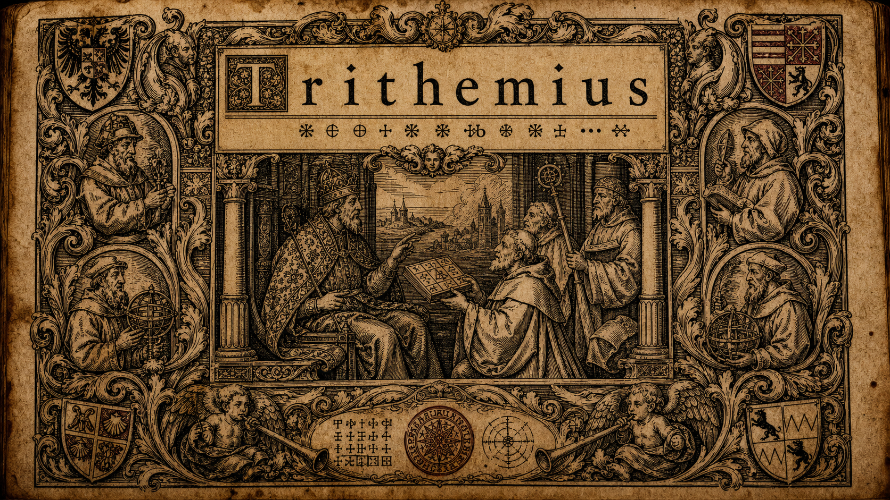

# Trithemius Corpus

[](https://trithemius-corpus.github.io/Trithemius-Corpus/)

**Read 29 Latin texts by or associated with Johannes Trithemius in machine-assisted English translation.** Trithemius (1462–1516), Benedictine abbot of Sponheim and later Würzburg, wrote on monastic life, pastoral care, history, bibliography, and cryptography. The collection also includes texts he transmitted and works traditionally attributed to him. [Browse the corpus](https://trithemius-corpus.github.io/Trithemius-Corpus/) · [Catalogue and source records](manifest.json)

## Read an edition

Choose a work and a printing in the catalogue. The standard reading page links to the Latin OCR, a side-by-side viewer, and downloadable EPUB and print editions. Where a second translation exists, the **Trithemius 4B** link opens a separate reading of the same witness. For some cipher tables and damaged passages, the **Special scholarly renderings** show a structured transcription or explanation alongside the source image. [Study reader guide](docs/STUDY_READER.md) · [Cipher guide](docs/CIPHERS.md)

| In this checkout | Coverage |
|---|---|
| Standard catalogue records | 47 for 29 distinct texts |
| Digitized sources | 45 distinct source-record URLs. Two pairs of catalogue records share a scan. |
| English reading editions | 47 standard and 27 additional Trithemius 4B editions |
| Standard translation chunks | 4,400, of which 4,353 have recorded historical machine grades |
| Downloadable books | 47 EPUBs and 47 print-ready HTML editions for the standard track |
| Complete human verification of a translation | 0 editions documented |

The manifest also identifies four excluded source records. The prior-English survey records earlier translations, excerpts, adaptations, and unresolved cases. For *In Praise of Scribes*, it identifies editions by Roland Behrendt (1974) and Elizabeth Bongie (1977). [Prior translations and survey scope](docs/PRIOR_TRANSLATIONS.md)

## Check a reading

In a standard edition, open **Study** to see the Latin segment associated with an English passage. The reader toolbar lets you copy the passage link. The 4B edition has its own English passage links and a separate OCR file in `works-t4b/<id>/`. Chunk numbers can differ between the two tracks. Where a reading matters to an argument, use the edition’s source record to check the print and cite the witness, track, and passage. OCR can misread an abbreviation or flatten a table, and two translations can agree on the same error. [Passage identifiers](docs/PASSAGE_MODEL.md) · [Methodology and limitations](METHODOLOGY.md)

For a worked example, compare the two translations of *In Praise of Scribes*. Its disagreement queue preserves earlier wording, photographed leaves, and the disputed pen reading that awaits a Latin reader. [Standard English](works/prdl-24362_de-laude-scriptorum-manualium/english.md) · [Trithemius 4B English](works-t4b/prdl-24362_de-laude-scriptorum-manualium/english.md) · [Scribes review guide](docs/TRANSLATION_DISAGREEMENTS.md)

A review of all 29 catalogue texts records 33 passage comparisons. A follow-up checked readings in nine works, including the Mainz colophon in *Scribes*, the page turn in *Seven Secondary Intelligences*, and the printed substitution alphabet in the *Clavis*. Both reports link to the witnesses and identify the readings that remain uncertain. [Corpus-wide translation review](docs/tasks/translation-quality-2026-11-17.md) · [Follow-up audit and evidence](docs/tasks/pre-push-review-2026-11-23.md)

Machine grades describe the text at the time of an audit. The edition records identify subsequent corrections, their evidence, and the documented scope of human review. [Editorial status by edition](data/editorial_status.json) · [Historical machine audit](docs/METHODOLOGY_GPT_AUDIT.md)

## Use the repository locally

Standard editions are in `works/<id>/`, and alternate editions are in `works-t4b/<id>/`. Start with `intro.md` for the headnote, `english.md` for the reading text, `latin-ocr.txt` for the transcription, and `metadata.json` for the source record. The `chunks/` directory contains the numbered English translation units. Where present, `ERRATA.md` records editorial changes. Scan-checked corrections also have dated evidence and preserved earlier wording. [Correction records](data/translation_disagreements/)

To use search and the study reader from a checkout, run the following from the repository root and open [the local reader](http://127.0.0.1:8000/).

```console
python -m http.server 8000 --bind 127.0.0.1 --directory site/dist
```

The prepared site is checked in. A fresh checkout supplies the facsimile images in `site/dist/static/images/`, which the builder carries forward. The release checklist gives the rebuild commands, regression tests, publication validators, and official EPUBCheck command. [Local build and release checks](docs/RELEASE_CHECKLIST.md) · [Book exports](docs/PUBLICATION_EXPORTS.md)

## Citation and rights

Fabin, Ian Carlos (2026). *Trithemius Corpus: machine-assisted English translations of Latin texts by or associated with Johannes Trithemius*. When citing the repository, include the release or commit you used. [Citation record](CITATION.cff)

The Latin texts are in the public domain. The project releases its English translations and generated corpus artifacts under **CC0 1.0**. Its documentation, code, and corpus arrangement are licensed under **CC BY 4.0**. Digitized page images and their crops carry the holding institution’s rights statement. The Trier *Sigilla* images are credited to Stadtbibliothek Trier under **CC BY-NC-SA 3.0**. The BSB scan of the Mainz prayer leaf carries **No Copyright – Non-Commercial Use Only**. [Project license](LICENSE) · [Trier credits](data/translation_disagreements/prdl-70291_dilibri_veterum-sophorum-sigilla-et-imagines-magicae/facsimiles/README.md) · [Mainz and Leipzig credits](data/translation_disagreements/prdl-24373_de-statu-et-ruina-monastici-ordinis/facsimiles/README.md)

## Contribute a correction

Include the work ID, translation track, passage or chunk, printed page or folio, and the wording you propose. A source image is especially helpful for names, negation, figures, and tables. The project is maintained by Ian Carlos Fabin (Carlosian). [Contribution guide](CONTRIBUTING.md) · [Maintainer](https://github.com/agentcarlosian)
